# Unified accounts

Status: **implemented** by migration `000066_unified_accounts.sql` (one migration: backfill, then drop the duplicated columns). Decisions: service accounts are workspace-level; soft-delete lives only on `accounts`; an agent authenticates with its own API key and acts with its own permissions only (no shared agent key, no `X-Agent-ID`, no `X-Actor-User-ID`); no per-key policy.

Goal: one `accounts` table for every actor (user, agent, service account), so API keys, role attachments, project membership and the authn/authz middleware each deal with one kind of principal. Design rules:

1. **Every fact is stored once.** A column lives on exactly one table. No mirrored `deleted_at`, no derived flags, no legacy column kept next to its replacement.
2. **Each rule has one owner.** Credentials resolve in one function, permissions come from `role_attachments` only, "is this account alive" is answered by `accounts` only.
3. **Type-specific data stays out of `accounts`.** `accounts` holds only what *every* kind has.

## Entity diagram

```mermaid
erDiagram
    accounts {
        uuid id PK
        text kind "user | agent | service_account"
        text name
        text description
        text avatar_key
        text avatar_thumb_key
        uuid created_by FK
        timestamptz created_at
        timestamptz updated_at
        timestamptz deleted_at "the ONLY soft-delete flag"
    }
    users {
        uuid id PK,FK
        text kind "constant user"
        text username "unique among live accounts"
        text email
        text password_hash
        bool must_change_password
    }
    agents {
        uuid id PK,FK
        text kind "constant agent"
        uuid project_id FK "NULL = global agent"
        text handle "unique per project / workspace"
        text agent_type "llm | acp"
        text llm_provider "... LLM / ACP / environment config"
    }
    user_identities { uuid id PK
        uuid user_id FK
        uuid provider_id FK
        text subject }
    password_set_tokens { uuid id PK
        uuid user_id FK }
    api_keys {
        uuid id PK
        uuid account_id FK
        text name
        text key_prefix
        text key_hash UK
        timestamptz last_used_at
        timestamptz expires_at
        timestamptz revoked_at
        uuid created_by FK
        timestamptz created_at
    }
    roles {
        uuid id PK
        text name
        jsonb policy
        uuid project_id FK "owner project, NULL = platform"
        bool is_system
        bool is_default
    }
    role_attachments {
        uuid id PK
        uuid role_id FK
        uuid account_id FK
        uuid project_id FK "NULL = platform-wide"
        uuid created_by FK
        timestamptz created_at
    }
    projects { uuid id PK }
    project_members {
        uuid id PK
        uuid project_id FK
        uuid account_id FK
        timestamptz created_at
        timestamptz deleted_at
    }
    activity_and_work_items["tasks, activities, assignees, docs ... (unchanged)"] { uuid member_id FK }
    audit_columns["files.uploaded_by, environments.created_by, annotations.*_by ..."] { uuid account_id FK }

    accounts ||--o| users : "kind=user"
    accounts ||--o| agents : "kind=agent"
    agents }o--o| projects : "project agent owner"
    accounts ||--o{ accounts : created_by
    users ||--o{ user_identities : "SSO"
    users ||--o{ password_set_tokens : ""
    accounts ||--o{ api_keys : "authenticates as"
    accounts ||--o{ role_attachments : "holds"
    roles ||--o{ role_attachments : "granted by"
    projects ||--o{ role_attachments : "scope"
    projects ||--o{ roles : "owns"
    accounts ||--o{ project_members : "joins"
    projects ||--o{ project_members : ""
    project_members ||--o{ activity_and_work_items : "actor / assignee"
    accounts ||--o{ audit_columns : "who did it"
```



Service accounts have **no extension table**: they have nothing a user or agent row would not already carry on `accounts` (name, description, avatar) plus `api_keys` and `role_attachments`. An empty table would be dead weight.

## Why each column is where it is

### `accounts` (every kind has these)

| Column | Notes |
|---|---|
| `id` | **Reuses the existing `users.id` / `agents.id`**, so no foreign key or `role_attachments.principal_id` has to be rewritten. |
| `kind` | `user`, `agent`, `service_account`. The only place the type of an actor is stored. |
| `name`, `description`, `avatar_key`, `avatar_thumb_key` | Were `users.full_name` and `agents.name`, and two copies of the avatar pair. Avatar upload/serve now takes an account id. |
| `created_by` | Who created the account (admin for a user, creator for an agent or service account). Was `agents.created_by`. |
| `created_at`, `updated_at` | Were on `users` and `agents` separately. |
| `deleted_at` | The **only** soft-delete flag. "Is this actor alive" is answered here and nowhere else. |

No `status`/`disabled` column: revoking keys and deleting the account already cover it, and a second "inactive" state would have to be checked everywhere `deleted_at` is.

```sql
CREATE TABLE accounts (
    id               UUID        PRIMARY KEY DEFAULT gen_random_uuid(),
    kind             TEXT        NOT NULL CHECK (kind IN ('user', 'agent', 'service_account')),
    name             TEXT        NOT NULL,
    description      TEXT        NOT NULL DEFAULT '',
    avatar_key       TEXT,
    avatar_thumb_key TEXT,
    created_by       UUID        REFERENCES accounts(id) ON DELETE SET NULL,
    created_at       TIMESTAMPTZ NOT NULL DEFAULT NOW(),
    updated_at       TIMESTAMPTZ NOT NULL DEFAULT NOW(),
    deleted_at       TIMESTAMPTZ,
    UNIQUE (id, kind)                          -- target of the kind-pinning FKs
);

CREATE INDEX idx_accounts_kind ON accounts (kind) WHERE deleted_at IS NULL;
```

### Identifier uniqueness without a second `deleted_at`

`users.username`, `users.email` and `agents.handle` must be unique among **live** accounts, but a partial index cannot read `accounts.deleted_at`, and copying the flag onto `users`/`agents` would make liveness two facts. So one constraint-trigger function, attached to both tables, rejects a row whose identifier is already held by a live account (`username` workspace-wide; `handle` per `project_id`, or workspace-wide when `project_id IS NULL`). Soft-deleting an account needs no extra work: it is no longer live, so its username/handle is free. This is the one piece of database-side logic the design adds; the alternatives are a copied `deleted_at` (duplicate data) or tombstone-renaming identifiers on delete (data mutation).

### `users` (user-only data)

Keeps `username` (the login name; users have both a `username` and a display `name`), `email`, `password_hash`, `must_change_password`. **Drops** `full_name`, `avatar_*`, `created_at`, `updated_at`, `deleted_at`, and the legacy `role_id` (roles come from `role_attachments` only). `user_identities`, `password_set_tokens` and `user_view_configs` keep pointing at `users(id)`: they only make sense for humans.

```sql
-- kind is a constant that exists only so the composite FK can pin the type;
-- it carries no information and cannot diverge from accounts.kind.
ALTER TABLE users
    ADD COLUMN kind TEXT NOT NULL DEFAULT 'user' CHECK (kind = 'user'),
    ADD CONSTRAINT fk_users_account FOREIGN KEY (id, kind) REFERENCES accounts (id, kind) ON DELETE CASCADE;
```

`users.email` is unique among live accounts too (it was `uni_users_email_active`), enforced by the same trigger. The `lower(email)` lookup index becomes a plain index; queries join `accounts` for liveness.

### `agents` (agent-only data)

Keeps `project_id` (NULL = global agent; only agents have an owning project, so it is not on `accounts`), `handle` (the @mention handle) and all agent configuration (LLM/ACP provider, system prompt, environment settings, parallelism, `acp_bridge_token_hash`). **Drops** `name`, `agent_scope` (it only mirrored `project_id IS NULL`), `avatar_*`, `created_by`, `created_at`, `updated_at`, `deleted_at`, `global_role_id`, `mcp_api_key_hash`. Same constant-`kind` composite FK as `users`, with `kind = 'agent'`.

`acp_bridge_token_hash` stays: it is a bridge-to-API transport secret, not an account credential.

### `api_keys`

| Column | Notes |
|---|---|
| `account_id` | Was `user_id`. FK to `accounts`, `ON DELETE CASCADE`. |
| `name`, `key_prefix`, `key_hash` (unique), `last_used_at`, `expires_at`, `revoked_at`, `created_at` | Unchanged. |
| `created_by` | **New.** Who minted it. For a service account this is the admin; otherwise equals `account_id`. Needed for audit of unattended credentials. |

No `purpose` column: an agent's MCP key is just a key of an `agent` account. `agents.mcp_api_key_hash` is migrated into an `api_keys` row (name `MCP key`, empty prefix) and dropped; regenerating it revokes the row and inserts a new one.

### `role_attachments`

`account_id` (FK, `ON DELETE CASCADE`) replaces `principal_type` + `principal_id`. The type is `accounts.kind`, so it was stored twice and unenforced. The old polymorphic pair had no FK, so deleted principals left orphans; that is now impossible. `created_by` now references `accounts`. Everything else is unchanged.

Roles are the **only** source of permission. This removes `users.role_id`, `agents.global_role_id`, `project_members.project_role_id`, and the legacy `global_roles` / `project_roles` tables (all already marked "dropped by a later migration" in 000064/000066).

### `project_members`

`account_id` replaces `user_id` + `agent_id` + `member_type` + `ck_pm_member_type_ref`. `project_members.id` stays: tasks, activities, assignees, docs and conversations already reference it as the actor, so none of those tables change. Unique active membership is `(project_id, account_id) WHERE deleted_at IS NULL`.

### Audit columns that name an actor

Today `files.uploaded_by`, `task_attachments.created_by`, `task_links.created_by`, `environments.created_by`, `environment_folders.created_by`, `environment_ssh_keys.created_by`, `environment_port_forwards.created_by`, `page_annotations.created_by/resolved_by`, annotation comments `created_by`, `workspace_settings.updated_by` and `project_exports.requested_by` point at `users(id)`. A service account that uploads a file would violate that FK, so they are **re-pointed to `accounts(id)`** (same ids, so it is just `DROP CONSTRAINT` / `ADD CONSTRAINT`).

Stay on `users(id)`, because they are human-only by nature: `user_identities`, `password_set_tokens`, `user_view_configs`, `notifications.recipient_user_id`, `agent_chat_sessions.actor_user_id` (the human chatting with a global agent).

## Authentication: one resolver

```
credential ──► applyAuthn ──► Principal{ AccountID, Kind, Method } ──► context
   session JWT (cookie / Bearer)   sub = the user's account id
   API key (ApiKey / X-API-Key)    key_hash -> api_keys.account_id (+ the account's kind)
```

- `applyAuthn` is the single place that turns a credential into an account. A session token is a user. An API key resolves through `api_keys` to the account that owns it, whatever its kind; the key of a deleted account does not resolve. Every other part of the API derives the caller from the `Principal` (`middleware.PrincipalFrom`).
- **An agent is whoever its API key proves.** The shared `AGENT_API_KEY`, `X-Agent-ID`, `X-Actor-User-ID`, the synthetic JWT built for API keys and `APIKey.AgentID` are gone, and so is `apikeysvc`'s agent lookup. An agent request is judged by the agent's own role attachments and by nothing else: when a person asks an agent to do something, only the agent's permissions are checked, never the person's. (`middleware.IAMPrincipalFrom` is `iam.Principal{ID: AccountID, Type: Kind}`.)
- **Where an agent gets its key.** A person generates one for an ACP agent (`POST .../mcp-agent-key`, an `api_keys` row named `MCP key`, shown once). For the agents `services/agent-runner` runs, the runner provides the key itself (`AgentKeyRepository.APIKeyFor`): an `api_keys` row named `agent-runner`, derived as `HMAC-SHA256(ENCRYPTION_KEY, agent id, revocation epoch)` so it is the same on every call and only its hash is stored. Stability matters because a sandbox bakes `PACA_API_KEY` into its environment; a random key per conversation would make the sandbox look stale and be recreated every time. Revoking the row moves the agent to the next epoch.
- `RequireJWTAuth` stays: minting or revoking a service account's keys needs a signed-in session, never another API key, so a leaked key cannot create more credentials.
- `iam_store.go` has no per-kind branch: the live account, then `project_members.account_id = role_attachments.account_id`.

## Service accounts

- IAM: action domain `service_accounts` (`read`, `write`) on resource root `service_account/*`; `principal.type` also accepts `service_account`. `user/` and `agent/` resource names are unchanged, so no stored policy breaks. `ADMIN` is not given the new actions; `SUPER_ADMIN` holds them through `*`.
- Endpoints: `GET/POST /admin/service-accounts`, `GET/PATCH/DELETE /admin/service-accounts/{id}`, avatar upload under `.../{id}/avatar/...`, `GET/POST /admin/service-accounts/{id}/api-keys` and `DELETE .../api-keys/{keyId}` (session only), and `GET/PUT /admin/service-accounts/{id}/roles` (`roles:assign` per role added or removed, like users and agents). A service account joins a project with `POST /projects/{id}/members` and `service_account_id`; project-scoped roles only apply while it is a member.
- A new service account holds no role (no default role is attached), has no `users` row so it cannot sign in, and cannot manage credentials. Deleting it soft-deletes the account and removes its attachments and memberships; its keys stop resolving because the account is deleted.
- Admin UI: Administration > Service accounts. The list shows each account with its roles (change them from the cell, like the users table) and links to a detail page with the profile (name, description, avatar), roles, API keys (minted once, revoked with a confirmation) and delete. In a project, **Team > Add member** has a Service account tab next to User and AI Agent (shown to anyone with `service_accounts:read`).

## What the migration does

One transaction: create `accounts`; backfill from `users` and `agents` reusing their ids; add the kind-pinning composite FKs; move `agents.mcp_api_key_hash` into `api_keys`; replace `role_attachments.principal_*` and `project_members.user_id/agent_id/member_type` with `account_id`; retarget the "who did it" columns to `accounts`; drop the duplicated and legacy columns; install `enforce_live_unique_identifiers` and `delete_owning_account`; then self-check. Orphan role attachments (a principal that no longer exists) are dropped with a NOTICE. It is irreversible. `test/integration/accounts_migration_test.go` runs it against a populated database.

Because the migration and the code ship together, there is no expand/contract split: the old columns are dropped in the same step.

## Code that changed

`middleware/authn.go` (one `Principal`, far smaller) and `authz_iam.go`; `domain/apikey` (`AccountID`/`AccountKind`, no `AgentID`); `domain/account` and `service/serviceaccount`; `repository/postgres` (`account_helpers.go`, `service_account_repository.go`, and the user, agent, project, role, activity, notification, annotation and document queries now join `accounts`); the role guards and role service (`ListServiceAccountRoles`, `ReplaceServiceAccountRoles`); `agent-runner` (queries, `AgentKeyRepository`); `apps/mcp` (no `X-Agent-ID`/`X-Actor-User-ID`); deploy files and the installer (`AGENT_API_KEY` removed); the web admin UI.

Cost to accept: repositories for users and agents always join `accounts` (name, avatar, liveness): one primary-key join, the price of storing each fact once.
